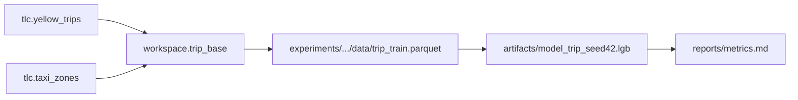

## Experiment Architecture Template

## Readability, in five lines

Full discipline: `.claude/rules/common/doc-readability.md`. The five habits it enforces:

1. A citation sits at the end of its sentence, once. Never mid-clause, never two per sentence.
2. A heading names its subject. The conclusion goes in the first sentence under it.
3. `##` only. A section that wants a `###` is a table or its own document.
4. A SoT, architecture, or overview document carries `## 핵심 불변식` — numbered, each line
   naming what verifies it.
5. Baselines, not caps: about 15 lines a section, about 150 a document. Crossing them prompts
   one question (is this two documents?) and nothing more.

Architecture docs live in `docs/architecture/` and answer one question a reader has before any
other: **what does this experiment pipeline currently look like, end to end?** Data lineage from
source tables through the snapshot to the feature set, the split design, the reproducibility
axes, and where a decision's history lives.

Scope boundary, because two neighbours are easy to confuse. This document holds the *current
shape*, so when the shape changes the stale text is deleted and rewritten
(`.claude/rules/common/sot-authoring.md` SOT-3). A decision's *history* — what was reversed, what
was rejected, why a rule exists — goes to `docs/architecture/adr/` instead, per the Decision
Routing test in `.claude/rules/workflow/05-doc.md`.

**Incorrect (a component list with no lineage and no reproducibility axis):**

```markdown
---
title: Trip duration pipeline
---

We extract with SQL, build features in python, train LightGBM, evaluate with MAE.
```

**Correct (full template):**

```markdown
---
type: Experiment Architecture
title: 운행시간 예측 파이프라인 구조
description: 소스에서 산출물까지의 계보·분할 설계·재현성 축
category: architecture
status: stable
created: 2026-08-24
updated: 2026-08-26
tags: trip-duration, lineage, split
generated: { by: ramo-doc-writer/claude-sonnet-5, at: 2026-08-26T09:00:00Z }
relates-to: src/trip_duration/train.py
depends-on: docs/data/trips-snapshot.md, docs/feature/trip-duration-features.md
---

# 운행시간 예측 파이프라인 구조

## 목적과 범위

무엇을 예측하는 파이프라인인지, 그리고 이 문서가 다루지 않는 것(서빙 경로, 다른 실험).

## 데이터 계보



| 단계 | 소유 레이어 | 산출물 | 재획득 방법 |
|---|---|---|---|
| 추출 | extraction | `workspace.trip_base` (intermediate) | `sql/trip_base.sql`, 스냅샷 `month=2023-01` |
| 피처 | feature | `trip_train.parquet` | `src/trip_duration/features.py::build` |
| 훈련 | training | `model_trip_seed42.lgb` | `uv run python -m trip_duration.train --config configs/v1.yaml` |

세 부분이 넘게 얽히면 그림을 넣음. 표만으로 의존 방향이 보이지 않을 때가 그 기준임.

## 타깃과 시점 경계

타깃 정의, 예측 앵커, 라벨 관측 시점. 이 세 개가 분할 설계와 누수 판정의 전제임.

## 분할 설계

| 항목 | 값 | 근거 |
|---|---|---|
| 방식 | 시간 분할 | 운영 시 미래를 예측하므로 무작위 분할은 낙관 편향 |
| 경계 | `split_boundary: 2023-01-22` | 1월 22일 이후를 valid 로 두어 약 10일 홀드아웃 확보 |
| 그룹 누수 | 승차 zone 중복 허용(의도적) | zone 단위 일반화가 목표가 아님. 희소 zone 은 슬라이스로 따로 봄 |

## 평가 슬라이스

선언된 지표와 필수 슬라이스, 그리고 베이스라인이 무엇인지
(`.claude/rules/model/eval-metric-slice.md`). 단일 집계값은 평가가 아님.

## 재현성 축

| 축 | 값 | 이 값이 없으면 |
|---|---|---|
| `seed` | 42 | 같은 설정의 다른 실행이 다른 산출물 |
| `split_boundary` | 2023-01-22 | 지표가 무엇에 대한 것인지 불명 |
| `data_snapshot` | `tlc.yellow_trips/month=2023-01` | 소스가 바뀌는지 알 수 없음 |
| `feature_spec` | `sha256:9f2a…` | 피처 집합이 고정되지 않아 재실행이 다른 실험 |

## 핵심 불변식

1. 소스 테이블은 읽기 전용이고 창고 쓰기는 워크스페이스 스키마에만 일어남
2. 피처 윈도의 상한은 예측 앵커 이전에 닫힘
3. 적합 변환은 train 분할에서만 적합됨
4. 지표는 선언된 슬라이스 전량에 대해 보고되며 집계값 단독은 결과가 아님

번호를 붙인 문장으로 씀. 나중에 어긋난 것을 발견했을 때 인용할 대상이 있어야 하고, 이 목록이
그 대상임. 이전 버전에서도 라이브 결함의 구조 수정이 이 목록의 한 항목으로 승격됐음.

## 결정 이력

이 구조에 이르기까지 뒤집힌 결정과 기각된 대안은 `docs/architecture/adr/` 에 있음:
- `adr/002-airport-trip-reinclusion.md`: 공항 트립 제외 → 재도입 (결정 뒤집힘)

## 확인 필요 사항

- 서빙 경로가 아직 없음. 배치 스케줄과 입력 계약은 결정되지 않았고 이 문서의 범위 밖임
```

Required sections: 목적과 범위, 데이터 계보, 타깃과 시점 경계, 분할 설계, 평가 슬라이스,
재현성 축, 핵심 불변식, 결정 이력, 확인 필요 사항.

- 핵심 불변식 is numbered so a later finding can cite one. It is the section a structural fix
  gets promoted into.
- 결정 이력 lists ADR paths only; the reasoning stays in the ADR, or SOT-3's next rewrite
  deletes it from here.
